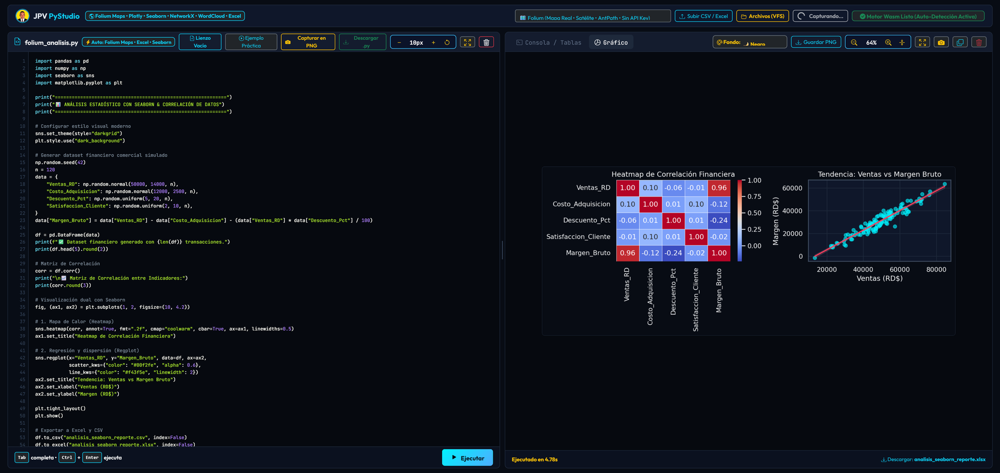
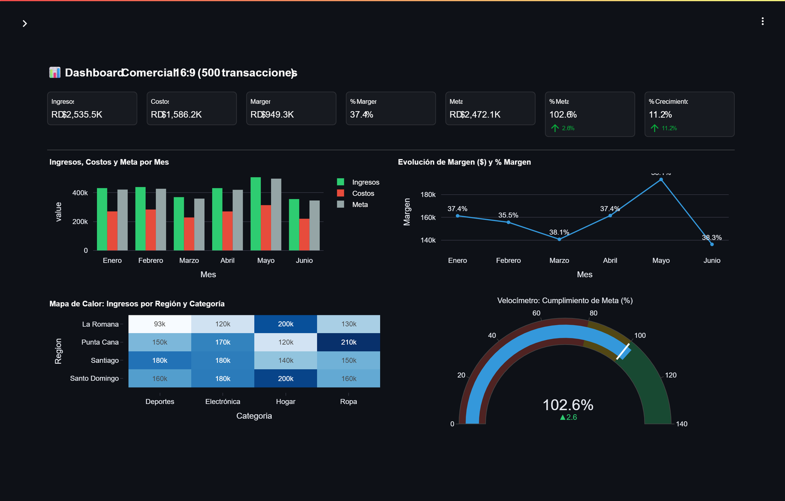
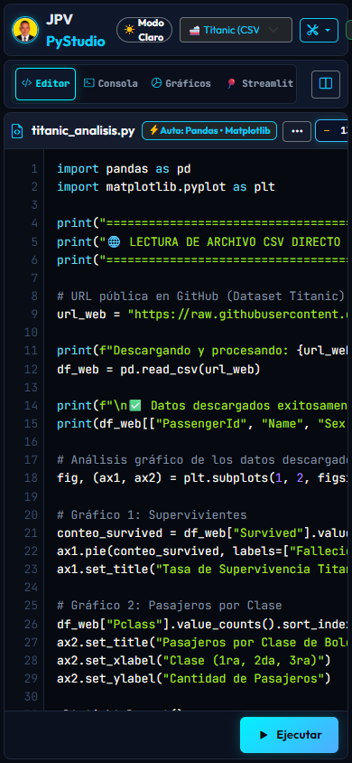
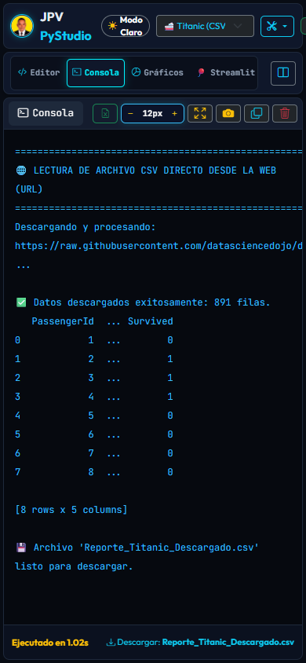
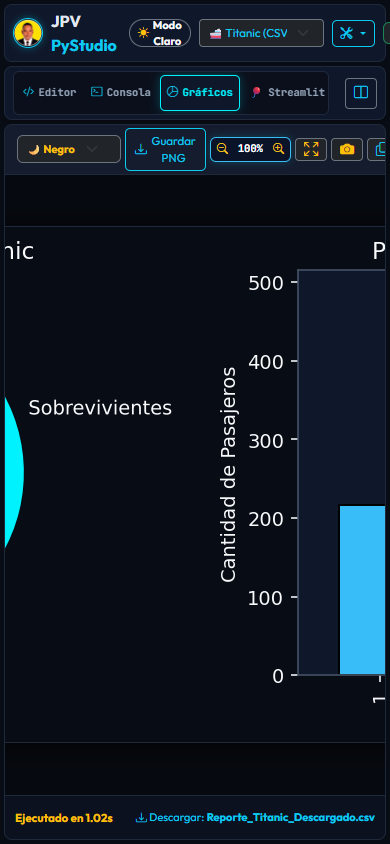
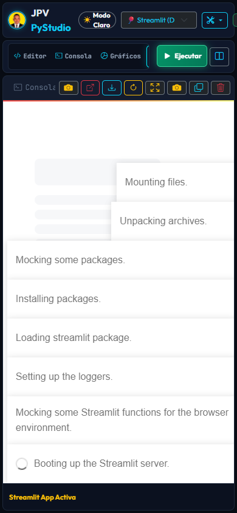
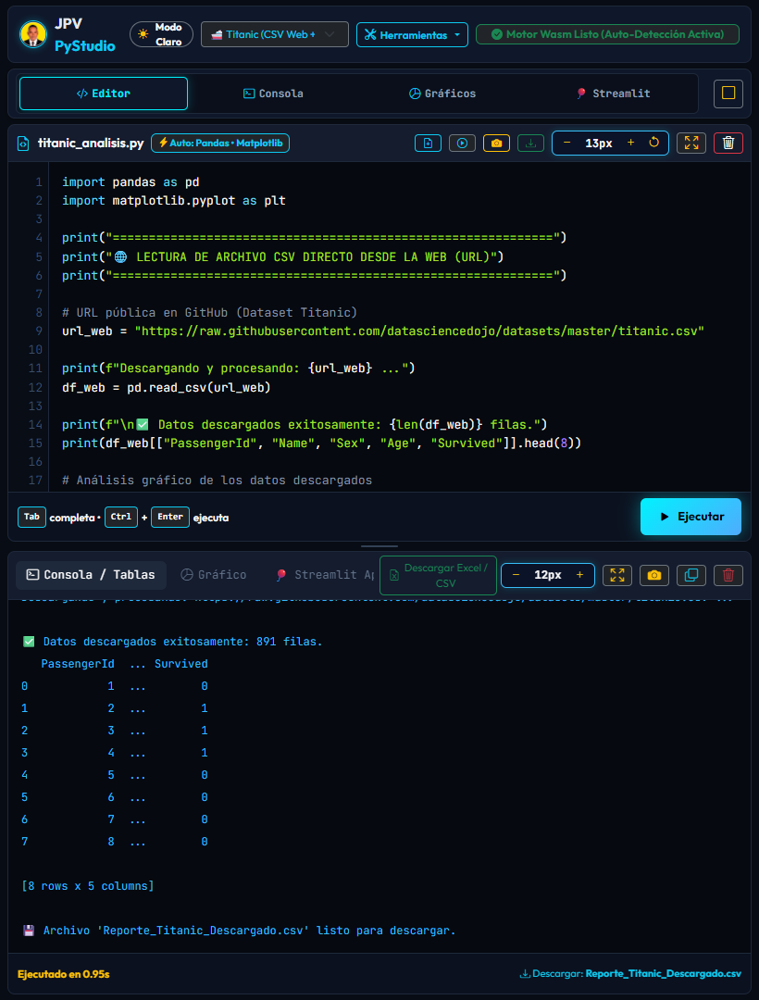
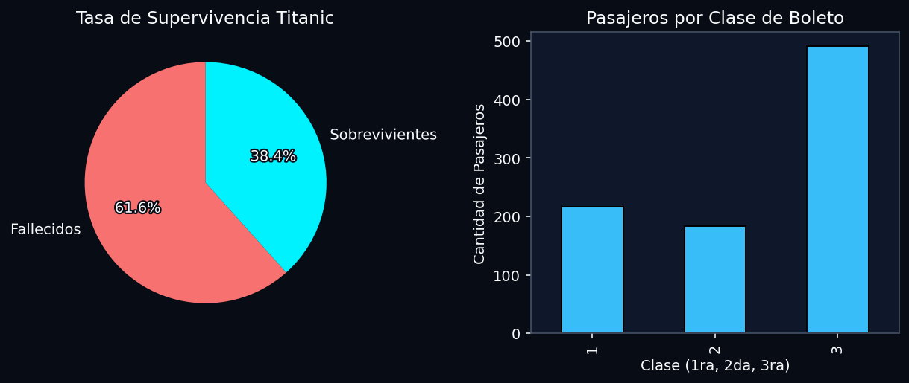
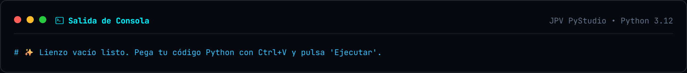

# 🐍 JPV PyStudio // WebAssembly Pro Studio
### *Estación de Trabajo Analítica, Ciencia de Datos y Desarrollo Python 100% en el Navegador*

<div align="center">

[](https://juancitopena.github.io/JPV_PyStudio/)
[-3776ab?style=for-the-badge&logo=python&logoColor=white)](https://pyodide.org/en/stable/)
[-ff4b4b?style=for-the-badge&logo=streamlit&logoColor=white)](https://juancitopena.github.io/JPV_PyStudio/)
[](LICENSE)
[](https://github.com/JUANCITOPENA/JPV_PyStudio/stargazers)
[](https://github.com/JUANCITOPENA/JPV_PyStudio/network/members)

**Cero instalaciones • Cero configuraciones • Cero servidores backend • 100% Privacidad en el Cliente**

[🌐 Abrir JPV PyStudio en Vivo](https://juancitopena.github.io/JPV_PyStudio/) • [🎈 Streamlit Wasm](#-desarrollo-de-aplicaciones-streamlit-100-en-el-navegador-stlite) • [📦 Suite de Descarga Global](#-suite-de-capturas-hd-y-descarga-global-en-zip) • [🎯 Casos de Uso](#-qué-puedes-lograr-con-jpv-pystudio-casos-de-uso--alcance-real) • [📸 Para Creadores](#-el-aliado-definitivo-para-creadores-de-contenido-docentes-y-divulgadores) • [👨‍💻 Sobre el Autor](#-autor--arquitectura-institucional-neo-brutalista)

<br>

<a href="https://juancitopena.github.io/JPV_PyStudio/">
  
</a>

<p align="center"><em>🖥️ <strong>JPV PyStudio en acción:</strong> Editor Monaco, Auto-Detección AST, Salida de Gráficos Adaptativos, Consola de Terminal y Suite de Capturas HD.</em></p>

</div>

---

> ### 🚀 **Acceso Directo al Entorno Web en Vivo:**  
> 👉 **[https://juancitopena.github.io/JPV_PyStudio/](https://juancitopena.github.io/JPV_PyStudio/)**  
> *(Listo para codificar de inmediato: sin instalaciones, sin registro, 100% en tu navegador con WebAssembly)*

---

## 📌 ¿Por qué JPV PyStudio? Para Estudiantes, Practicantes y Docentes

El mayor obstáculo que enfrenta un estudiante, docente o profesional al aprender **Python y Ciencia de Datos** no es la lógica de programación: es el **infierno de la configuración del entorno local (*Environment Setup Hell*)**:

- Conflictos entre versiones de Python en el sistema operativo.
- Entornos virtuales corruptos (`venv`, `conda`) y fallos de compilación con `pip install`.
- Restricciones de permisos de administrador en computadoras de laboratorios escolares, bibliotecas o PCs corporativas.
- Laptops de bajos recursos donde instalar suites pesadas o contenedores Docker paraliza la máquina.
- Dependencia de servidores remotos (Google Colab, Binder) que sufren desconexiones por inactividad, colas de espera, consumen datos móviles y exigen crear cuentas o iniciar sesión.

### 🎯 La Solución: Abrir el navegador y codificar al instante
**JPV PyStudio** democratiza el acceso a la computación científica transformando cualquier navegador moderno (Google Chrome, Edge, Safari, Firefox) en una **estación de trabajo completa y autónoma**. No requiere instalar ningún ejecutable, no consume recursos en la nube y funciona de forma inmediata:

1. **Abres la URL** en tu navegador.
2. **Escribes tu código Python** o seleccionas plantillas preconstruidas (*Pandas, Streamlit, Folium, Plotly, Seaborn, NetworkX, WordCloud, Excel*).
3. **Pulsas `Ejecutar` (`Ctrl + Enter`)**: el motor compila y procesa los datos en la memoria RAM de tu propio equipo.
4. **Visualizas resultados**: aplicaciones Streamlit interactivas, tablas dinámicas, mapas geoespaciales y gráficos estadísticos sincronizados.
5. **Exportas tu trabajo**: descarga datasets limpios en CSV/Excel, el archivo fuente `.py`, imágenes de gráficos y la **Suite Completa en archivo ZIP con capturas fotográficas en alta resolución**.

---

## 🎈 Desarrollo de Aplicaciones Streamlit 100% en el Navegador (stlite)

**JPV PyStudio** incorpora un motor WebAssembly de **Streamlit** impulsado por `@stlite/mountable`. Esto te permite concebir, programar y probar tableros de control ejecutivos y aplicaciones interactivas completas con la sintaxis oficial `import streamlit as st` sin levantar servidores Python locales ni máquinas virtuales en la nube:

<div align="center">
  <a href="https://juancitopena.github.io/JPV_PyStudio/">
    
  </a>
  <p><em>🎈 Dashboard Comercial Interactivo creado con Streamlit (`stlite`) + Plotly Express dentro de JPV PyStudio.</em></p>
</div>

### 🌟 Capacidades de Streamlit en JPV PyStudio:
- **Componentes Nativos Soportados:** `st.title()`, `st.metric()`, `st.columns()`, `st.divider()`, `st.subheader()`, `st.dataframe()`, `st.plotly_chart()`, `st.button()`, `st.selectbox()`, `st.slider()` y más.
- **Pestaña Dedicada de Visualización:** Al detectar `import streamlit` o `st.*`, el editor conmuta automáticamente a la pestaña **🎈 Streamlit** con recarga dinámica en caliente.
- **Herramientas de Exportación para Streamlit:**
  - 🌐 **Abrir en Pestaña Independiente:** Despliega tu dashboard a pantalla completa en una nueva ventana del navegador.
  - 💾 **Guardar HTML Autónomo:** Descarga un único archivo `.html` autocontenido con la app embebida, listo para enviar por correo o compartir sin requerir Python.
  - 📸 **Capturar Streamlit (PNG HD):** Genera una captura de pantalla en resolución 2x Retina exclusivamente de tu aplicación web interactiva.

---

## 📱 Experiencia Responsive Pro: Móvil, Tablet y Escritorio

**JPV PyStudio** ha sido optimizado con una arquitectura responsive de nivel profesional que se adapta fluidamente desde pantallas móviles (320px) hasta tablets y monitores de alta resolución:

<div align="center">
  <table width="100%">
    <tr>
      <td width="25%" align="center">
        
        <br><sub>📱 <b>Móvil: Editor</b><br>Header compacto y ejecución directa</sub>
      </td>
      <td width="25%" align="center">
        
        <br><sub>💻 <b>Móvil: Consola</b><br>Salida interactiva en tiempo real</sub>
      </td>
      <td width="25%" align="center">
        
        <br><sub>📊 <b>Móvil: Gráficos</b><br>Visualizaciones Matplotlib y temas</sub>
      </td>
      <td width="25%" align="center">
        
        <br><sub>🎈 <b>Móvil: Streamlit</b><br>Apps interactivas Wasm en tu teléfono</sub>
      </td>
    </tr>
  </table>
  <br>
  
  <p><em>📟 <strong>Modo Tablet / iPad:</strong> Espacio de trabajo dividido verticalmente con splitter táctil y toolbars ergonómicas.</em></p>
</div>

### 🌟 Características de la Arquitectura Responsive:
- **Navegación Móvil Segmentada (`Mobile View Switcher`):** En smartphones, conmuta con un solo toque entre `[ 📝 Editor ]`, `[ 💻 Consola ]`, `[ 📊 Gráficos ]` y `[ 🎈 Streamlit ]`, maximizando el área útil de trabajo sin scroll horizontal.
- **Modo Dividido Vertical para Tablets:** Permite alternar entre pestañas móviles y vista dividida vertical (`mobile-split-vertical`), aprovechando el formato vertical u horizontal de tablets y iPads.
- **Soporte Táctil Completo (`Touch Gestures`):** Divisor de paneles y visor de gráficos redimensionables con gestos táctiles directos (`touchstart`, `touchmove`, `touchend`).
- **Dynamic Viewport Height (`100dvh`):** Cero desbordamientos o solapamientos con las barras de navegación de iOS Safari y Android Chrome.
- **Accesibilidad WCAG 2.2 AA:** Botón de ejecución y controles principales con zonas de toque táctiles de al menos 44px de alto.

---

## 🏛️ Arquitectura Modular y Desacople de Código (JS / CSS)

Para maximizar la mantenibilidad, escalabilidad y rendimiento en el navegador, **JPV PyStudio** fue estructurado bajo una arquitectura modular limpia y desacoplada:

```
JPV_PyStudio/
├── index.html                   # Interfaz de usuario y maquetación semántica principal
├── css/
│   └── styles.css               # Estilos globales, variables de color y temas (Dark / Light)
├── js/
│   ├── globals.js               # Estado global y referencias a elementos del DOM
│   ├── layout.js                # Control de divisores (splitters), pestañas y maximización
│   ├── editor.js                # Resaltado de sintaxis con Prism, autocompletado y atajos
│   ├── terminal.js              # Consola de salida interactiva con formateo ANSI y tablas
│   ├── vfs.js                   # Sistema de archivos virtual Pyodide (drag & drop y modal)
│   ├── visualizer.js            # Visor interactivo de Matplotlib, Folium y gráficos HTML
│   ├── templates.js             # Catálogo de plantillas maestras (Titanic, Scipy, Streamlit, Tokens)
│   ├── diagnostics.js           # Análisis estático AST en tiempo real para detección de módulos
│   ├── pyodide-engine.js        # Motor de inicialización y ejecución WebAssembly (CPython 3.12)
│   ├── streamlit-engine.js      # Integración y montaje dinámico de Streamlit Wasm (stlite)
│   ├── captures_engine_v7.js    # Motor Maestro V7 de Capturas HD (Pantalla, Código, Streamlit)
│   └── app.js                   # Inicialización y arranque coordinado del estudio
├── bridge_mercado.py            # Servidor puente CORS local opcional para APIs financieras
└── INICIAR_PUENTE_MERCADO.bat   # Lanzador rápido en 1 clic para cotizaciones en vivo
```

---

## 📦 Suite de Capturas HD y Descarga Global en ZIP

Hemos incorporado el botón maestro **`📦 Descargar Todo (Suite)`** en la barra superior del IDE, permitiéndote empaquetar en un único archivo comprimido `.zip` todos los resultados de tu sesión de trabajo con un solo clic:

```
📦 JPV_PyStudio_Suite_Completa_YYYYMMDD_HHMMSS.zip
├── 00_Pantalla_Completa_PyStudio.png   # Captura integral del IDE (incluye iframe de Streamlit/Plotly compuesto)
├── 01_codigo_fuente.py                 # Script Python limpio del editor Monaco
├── 01_Captura_Codigo_HD.png            # Tarjeta de código estilo macOS con sintaxis Prism Okaidia
├── 02_salida_consola.txt               # Log completo de terminal en texto plano
├── 02_Captura_Consola_HD.png           # Imagen de la consola con formato visual y colores
├── 03_Grafico_Matplotlib_HD.png        # Gráfico estático en alta resolución (si fue generado)
├── 03_Animacion_Generada.gif           # Animación gráfica en bucle (si fue generada)
├── 03_Grafico_Interactivo.html         # Visualización HTML interactiva de Plotly o Folium
├── 04_Captura_Streamlit_App_HD.png     # Captura en alta resolución de la app Streamlit (si está activa)
└── 04_Streamlit_App_Autonoma.html      # Archivo HTML autocontenido de la aplicación Streamlit
```

<div align="center">
  <table width="100%">
    <tr>
      <td width="50%" align="center">
        
        <br><sub>📊 Gráficos Estadísticos con Fondos Adaptativos (Dark / White / Transparent)</sub>
      </td>
      <td width="50%" align="center">
        
        <br><sub>🖥️ Terminal Interactiva con Captura HD de Resultados y Tabulate</sub>
      </td>
    </tr>
  </table>
</div>

---

## 🌓 Selector de Tema Dual: Modo Claro y Modo Oscuro (WCAG 2.2 AAA)

Para responder a entornos académicos y profesionales variados, **JPV PyStudio** incluye un interruptor de tema instantáneo en el encabezado (`#btn-toggle-tema`):

- **Modo Oscuro (Predeterminado):** Estética técnica hacker inspirada en suites de ingeniería, reduciendo la fatiga visual en sesiones prolongadas.
- **Modo Claro (WCAG 2.2 AAA):** Diseñado con fondos blancos/neutros de alto contraste (`#FFFFFF` y `#F8FAFC`) con tipografía oscura (`#0F172A`), ideal para proyectores en aulas universitarias, conferencias o auditorios con iluminación directa.
- **Persistencia Local:** La preferencia se almacena automáticamente en `localStorage` para mantenerse activa entre recargas.

---

## 🎯 ¿Qué Puedes Lograr con JPV PyStudio? (Casos de Uso & Alcance Real)

Con **JPV PyStudio** dispones en una sola pestaña del navegador del ecosistema de librerías más completo de la ciencia de datos moderna:

```
┌─────────────────────────────────────────────────────────────────────────────────────────┐
│                          ALCANCE TÉCNICO EN UNA SOLA PESTAÑA                            │
├──────────────────────────┬─────────────────────────────┬────────────────────────────────┤
│   CIENCIA DE DATOS & EDA │   VISUALIZACIÓN AVANZADA    │   AUTOMATIZACIÓN & ARCHIVOS    │
│   • Pandas & NumPy       │   • Streamlit (Apps Wasm)   │   • Excel (.xlsx con openpyxl) │
│   • SciPy & SymPy        │   • Folium (Mapas & Rutas)  │   • Tabulate (Tablas Consola)  │
│   • Scikit-Learn (ML)    │   • Plotly Express (HTML5)  │   • CSV & JSON bidireccional   │
│   • Statsmodels          │   • Seaborn & Matplotlib    │   • Drag & Drop directo a RAM  │
│   • Micropip (PyPI)      │   • NetworkX & WordCloud    │   • Descarga del script .py    │
└──────────────────────────┴─────────────────────────────┴────────────────────────────────┘
```

### 1. 📊 Análisis Exploratorio de Datos (EDA) en Segundos
- Descarga y procesamiento de datasets desde URLs públicas (por ejemplo, el dataset Titanic o repositorios de GitHub) directamente con `pd.read_csv(url)`.
- Limpieza de datos, imputación de nulos, agregaciones (`groupby`), tablas pivote y cálculo de matrices de correlación estadística sin instalar paquetes en la máquina física.

### 2. 🎈 Aplicaciones Web y Cuadros de Mando con Streamlit
- Creación rápida de interfaces interactivas para presentar modelos predictivos, KPIs y reportes ejecutivos con métricas dinámicas (`st.metric`), columnas paralelas y selectores.

### 3. 🗺️ Geointeligencia y Mapas Interactivos en Vivo (Folium)
- Renderizado de mapas interactivos completos con zoom, capas satelitales OpenStreetMap, mapas de calor (`HeatMap`) y clústeres de marcadores (`MarkerCluster`).
- Visualización de trazas de movimiento y logística animada con `AntPath`.
- Botón **"Abrir en Pestaña"** para desplegar el mapa interactivo a pantalla completa o exportarlo para presentaciones.

### 4. 📈 Dashboards Interactivos en HTML (Plotly Express & Bokeh)
- Gráficos interactivos de dispersión, líneas multieje, diagramas de caja (*Box Plots*), histogramas y gráficos solares (*Sunburst*).
- Tooltips flotantes, zoom rectangular, aislamiento de series mediante clics en la leyenda y renderizado fluido sin latencia de red.

### 5. 🕸️ Modelado de Redes Complejas y Topología de Grafos (NetworkX)
- Construcción de grafos dirigidos y no dirigidos, análisis de centralidad, cálculo del camino más corto (Algoritmo de Dijkstra) y diagramas de topología visual.

### 6. ☁️ Minería de Texto & Procesamiento de Lenguaje Natural (WordCloud)
- Análisis de frecuencia de palabras y generación de nubes de términos en alta definición para resumir discursos, encuestas o artículos académicos.

### 7. 📑 Automatización Contable y Ofimática Multicapa (Excel .xlsx & Tabulate)
- Generación de libros de cálculo de Microsoft Excel con múltiples hojas, estilos de celda, formatos contables y fórmulas dinámicas mediante `openpyxl` y `xlsxwriter`.
- Formato de tablas ejecutivas en consola mediante `tabulate` (estilo `fancy_grid`, `github`, `psql`).

### 8. 🤖 Machine Learning Clásico & Modelado Predictivo (Scikit-Learn)
- Entrenamiento en memoria de algoritmos supervisados y no supervisados: Regresión Lineal, Regresión Logística, Árboles de Decisión, Random Forest y agrupamiento K-Means.
- Evaluación de métricas de precisión, matrices de confusión y curvas ROC de forma instantánea.

### 9. 🌐 Consumo Seguro de APIs REST Públicas
- Ejecución de peticiones HTTPS a servicios web y APIs abiertas en vivo (`requests` parcheado con conectividad WebAssembly) para consultar datos meteorológicos, cotizaciones financieras, indicadores económicos o endpoints públicos.

---

## 🎨 El Aliado Definitivo para Creadores de Contenido, Docentes y Divulgadores

¿Publicas contenido técnico en **LinkedIn, Twitter/X, Instagram, YouTube, TikTok o blogs de Medium/Dev.to**? ¿Eres docente y preparas diapositivas o guías para tus alumnos?

**JPV PyStudio** fue diseñado para erradicar las capturas de pantalla feas, pixeladas y desordenadas, ofreciendo un flujo de trabajo de publicación profesional en menos de 2 minutos:

```
                  EL FLUJO DE ORO DEL CREADOR DE CONTENIDO (2 MINUTOS)
┌────────────────────┐      ┌─────────────────────────┐      ┌─────────────────────────┐
│ 1. Escribe / Prueba│      │ 2. Captura Código en    │      │ 3. Exporta Gráficos     │
│    tu código en    │ ───► │    PNG HD (Mac Style)   │ ───► │    (Fondo Transparente, │
│    JPV PyStudio    │      │    (Copiar al Portapap.)│      │    Dark o White)        │
└────────────────────┘      └─────────────────────────┘      └─────────────────────────┘
                                                                          │
                                                                          ▼
                                                             ┌─────────────────────────┐
                                                             │ 4. Descarga la Suite    │
                                                             │    Completa en ZIP y    │
                                                             │    ¡Publica tu Post!    │
                                                             └─────────────────────────┘
```

### 📸 1. Captura Fotográfica del Código en Imagen PNG HD (2x Retina)
- **Adiós a los recortes manuales de pantalla con Snipping Tool:** no más capturas borrosas con fuentes pixeladas que se ven mal en dispositivos móviles.
- **Tarjeta de Ventana Estilo macOS:** Marco premium con los tres botones circulares (rojo, amarillo, verde), título del archivo, números de línea perfectamente alineados y coloreado de sintaxis **Prism Okaidia** de alto contraste.
- **Captura Integral del 100% de las Líneas:** El motor toma el código completo de arriba a abajo, sin importar que tenga 20, 50 o 200 líneas y esté oculto por el scroll del editor.
- **Selector de Fondos para Cada Estilo de Contenido:**
  - 🌌 **Neón Nocturno (Gradiente):** Ideal para posts llamativos en LinkedIn y Twitter/X que detienen el scroll.
  - 🔷 **Cyan Studio:** Look moderno de ingeniería y ciencia de datos.
  - ⬛ **Dark Studio Puro:** Estética minimalista hacker y sobria.
  - ☀️ **Blanco Limpio:** Diseñado para manuales impresos, libros, tesis universitarias o artículos de blog técnicos.
  - 🏁 **Transparente (Sin Marco):** Para diseñadores que desean incrustar el código en plantillas de Canva, Figma, PowerPoint o Keynote sin bordes molestos.
- **Botón `Copiar Imagen` al Portapapeles:** Olvídate de guardar archivos temporales en el disco. Pulsa *Copiar Imagen* y dale `Ctrl + V` directamente en el compositor de LinkedIn, Twitter/X, Discord o Notion.

### 🖼️ 2. Exportación de Resultados y Gráficos con Fondo Adaptativo
- **Fondo Transparente:** Exporta gráficos de Matplotlib o Seaborn sin fondo para superponerlos directamente sobre cualquier diapositiva o infografía manteniendo un diseño limpio.
- **Fondo Negro:** Optimizado para lectores en modo oscuro (*Dark Mode*) en redes sociales.
- **Fondo Blanco:** Conforme a los estándares editoriales para artículos científicos, publicaciones en PDF o entregas académicas.

---

## 🔬 ¿Por qué usamos Pyodide (WebAssembly)?

[Pyodide](https://pyodide.org/en/stable/) es el proyecto de referencia de la **Python Software Foundation** y la comunidad de código abierto para llevar el runtime oficial de **CPython** al estándar **WebAssembly (Wasm)** mediante la cadena de herramientas de **Emscripten**.

### ¿Qué nos ofrece Pyodide en JPV PyStudio?
1. **CPython Real en WebAssembly:** No es un intérprete recortado ni una reimplementación parcial; es CPython 3.12 compilado a binarios Wasm, manteniendo compatibilidad total con la semántica del lenguaje.
2. **Paquetes con Extensiones C/C++/Fortran:** A diferencia de proyectos que solo admiten Python puro, Pyodide incluye compilaciones optimizadas de bibliotecas pesadas en C como `numpy`, `scipy` y `pandas`.
3. **Puente Bidireccional Python ⇄ JavaScript:** Permite interactuar con el DOM del navegador, renderizar mapas `folium` y apps `streamlit` en iframes en vivo, manipular gráficos SVG/Canvas y gestionar descargas nativas sin intermediarios.
4. **Aislamiento Seguro en Sandbox:** El código Python se ejecuta dentro del sandbox de seguridad del navegador, impidiendo accesos no autorizados al sistema operativo del usuario.

### ⚖️ Comparativa: JPV PyStudio frente a otras opciones

| Solución | Servidor Requerido | Soporte Pandas/NumPy | Soporte Streamlit | Tiempo de Inicio | Requiere Registro | Captura de Código PNG | Suite ZIP Completa |
| :--- | :---: | :---: | :---: | :---: | :---: | :---: | :---: |
| **🐍 JPV PyStudio** | ❌ **No (100% Cliente)** | ✅ **Completo (Wasm)** | ✅ **Sí (stlite)** | ⚡ **1-2 segundos** | ❌ **No** | ✅ **Sí (Nativo HD 2x)** | ✅ **Sí (1 Clic)** |
| **JupyterLite** | ❌ No (Cliente) | ✅ Completo | ❌ No | ⏳ 8-15 segundos | ❌ No | ❌ Requiere plugins | ❌ No |
| **Brython / Skulpt** | ❌ No (Cliente) | ❌ Muy limitado (Sin C) | ❌ No | ⚡ Instantáneo | ❌ No | ❌ No | ❌ No |
| **Google Colab** | ✅ Sí (Cloud VM) | ✅ Completo | ⚠️ Requiere ngrok/túnel | ⏳ 15-30 segundos | ✅ Sí (Cuenta Google) | ❌ Extensiones ajenas | ❌ No |
| **Python Local (VS Code)** | ❌ No (Local) | ✅ Completo | ✅ Local | ⏳ Horas de setup | ❌ No | ❌ Requiere Polacode | ❌ No |

---

## 🗺️ Roadmap de Escalamiento e Innovación Futura

- [x] Motor Pyodide v0.26.1 con soporte CPython 3.12.
- [x] **Arquitectura Modular JS/CSS:** Desacople estructurado en módulos (`css/styles.css`, `js/globals.js`, `vfs.js`, `terminal.js`, `visualizer.js`, `templates.js`, `editor.js`, `layout.js`, `diagnostics.js`, `pyodide-engine.js`, `streamlit-engine.js`, `captures_engine_v7.js`, `app.js`).
- [x] **Integración de Streamlit en WebAssembly (`stlite`) con visor reactivo.**
- [x] **Plantilla Dashboard Dinámico:** Cotizaciones y minigráficos de tokens y empresas tech (`dashboard_tokens`) con soporte de puente CORS local (`bridge_mercado.py`).
- [x] **Selector de Tema Dual (Modo Claro / Modo Oscuro) con accesibilidad WCAG 2.2 AAA.**
- [x] **Suite de Descarga Global en ZIP con empaquetado de código, consola, gráficos y Streamlit.**
- [x] **Motor Maestro de Captura HD V7 (`captures_engine_v7.js`):** Composición exacta 2D sin recortes, reinicio de matriz de transformación en `html2canvas` y captura fiel de apps Streamlit.
- [x] **Modal de Captura de Código Global:** Snapshots de alta fidelidad con 5 temas visuales, números de línea, barra macOS y copia directa al portapapeles.
- [x] Auto-detección sintáctica de dependencias vía AST con instalación dinámica `micropip`.
- [x] Visor de gráficos unificado con fondos transparente/blanco/negro y descarga PNG.
- [x] Sistema de Archivos Virtual (VFS) con drag & drop de archivos CSV/Excel.
- [x] Botón de Descarga Directa del Script Python (`.py`).
- [ ] **Soporte PWA Offline-First:** Almacenamiento en caché de paquetes WebAssembly mediante Service Workers para programar en aviones o zonas sin internet.
- [ ] **Integración de DuckDB-Wasm:** Consultas SQL analíticas ultrarrápidas sobre archivos Parquet y CSV de gigabytes en la RAM del navegador.
- [ ] **Soporte de WebGPU:** Inferencia de modelos pequeños de lenguaje (LLMs / SLMs locales) para autocompletado y tutoría de código asistida por IA local.

---

## 👨‍💻 Autor & Arquitectura Institucional (Neo-Brutalista)

<div align="center">

```
┌─────────────────────────────────────────────────────────────────────────────┐
│                       ING. JUANCITO PEÑA VIZCAÍNO                           │
│  ┌───────────────────────┐  Ingeniero en Sistemas y Computación             │
│  │                       │  Postgrado en Ingeniería de Software             │
│  │        [ FOTO ]       │  Maestría en Sistemas Mención Gerencial          │
│  │                       │  Universidad Dominicana O&M                      │
│  └───────────────────────┘  Más de 15 años de trayectoria profesional       │
│  [Data Analyst]  [Full Stack Dev]  [AI & API Expert]  [Líder I+D+i]         │
└─────────────────────────────────────────────────────────────────────────────┘
```

</div>

<table align="center" style="border: 3px solid #000000; box-shadow: 6px 6px 0px #000000; background-color: #ffffff; border-radius: 8px; max-width: 900px; width: 100%; border-collapse: separate;">
  <tr>
    <td style="padding: 24px; vertical-align: top; width: 65%; border-right: 2px solid #000000; background-color: #ffffff;">
      <div style="display: flex; align-items: center; gap: 16px; margin-bottom: 16px;">
        
        <div>
          <h2 style="margin: 0; font-size: 20px; font-weight: 800; color: #000000;">Ing. Juancito Peña Vizcaíno</h2>
          <div style="margin-top: 6px; display: flex; flex-wrap: wrap; gap: 6px;">
            <span style="background: #000000; color: #ffffff; padding: 2px 8px; font-size: 11px; font-weight: bold; border-radius: 4px;">Data Analyst</span>
            <span style="background: #da291c; color: #ffffff; padding: 2px 8px; font-size: 11px; font-weight: bold; border-radius: 4px;">Full Stack Dev</span>
            <span style="background: #0d6efd; color: #ffffff; padding: 2px 8px; font-size: 11px; font-weight: bold; border-radius: 4px;">AI & API Expert</span>
            <span style="background: #ffc107; color: #000000; padding: 2px 8px; font-size: 11px; font-weight: bold; border-radius: 4px; border: 1px solid #000000;">Líder I+D+i</span>
          </div>
        </div>
      </div>
      <p style="color: #0f172a; font-size: 13.5px; line-height: 1.65; margin-bottom: 12px; font-weight: 500;">
        <strong>Ingeniero en Sistemas y Computación</strong> con Postgrado en <strong>Ingeniería de Software</strong> y Maestría en <strong>Sistemas Mención Gerencial</strong> (<em>Universidad Dominicana O&amp;M</em>). Con más de <strong>15 años de trayectoria</strong>, transformo problemas de alta complejidad en soluciones escalables. Durante el último año, he centrado mi trabajo en <strong>I+D+i (Investigación, Desarrollo e Innovación)</strong>, explorando arquitecturas de <strong>IA Generativa (RAG / LLMs)</strong>, integración de agentes autónomos con bases de datos y orquestación de APIs empresariales.
      </p>
      <p style="color: #0f172a; font-size: 13.5px; line-height: 1.65; margin: 0; font-weight: 500;">
        🔬 <strong>Mi motor es el aprendizaje a través de los retos:</strong> me apasionan los <em>casos de uso reales</em>, las <strong>pruebas técnicas rigurosas</strong>, la investigación profunda y el diseño de soluciones directas a problemas de ingeniería. 🎓 Como <strong>docente universitario</strong> y creador del canal educativo <strong><a href="https://www.youtube.com/@JuancitoDevV" target="_blank" style="color: #da291c; font-weight: bold; text-decoration: underline;">@JuancitoDevV</a></strong>, comparto este conocimiento práctico mediante ejercicios y proyectos de código abierto para acercar la tecnología a problemas reales. 🚀
      </p>
    </td>
    <td style="padding: 24px; vertical-align: top; width: 35%; background-color: #f8fafc;">
      <h3 style="margin-top: 0; font-size: 14px; text-transform: uppercase; letter-spacing: 0.5px; font-weight: 800; color: #000000; border-bottom: 2px solid #000000; padding-bottom: 6px;">
        🌐 Canales y Conexión Oficial
      </h3>
      <ul style="list-style: none; padding: 0; margin: 0 0 20px 0; font-size: 13px;">
        <li style="margin-bottom: 10px;">
          <a href="https://www.linkedin.com/in/juancitope%C3%B1a/" target="_blank" style="text-decoration: none; color: #0d6efd; font-weight: bold; display: flex; align-items: center; gap: 8px;">
            <span>💼</span> LinkedIn Oficial
          </a>
        </li>
        <li style="margin-bottom: 10px;">
          <a href="https://www.youtube.com/@JuancitoDevV" target="_blank" style="text-decoration: none; color: #da291c; font-weight: bold; display: flex; align-items: center; gap: 8px;">
            <span>▶️</span> YouTube (@JuancitoDevV)
          </a>
        </li>
        <li style="margin-bottom: 10px;">
          <a href="https://github.com/JUANCITOPENA" target="_blank" style="text-decoration: none; color: #000000; font-weight: bold; display: flex; align-items: center; gap: 8px;">
            <span>🐙</span> GitHub (@JUANCITOPENA)
          </a>
        </li>
        <li style="margin-bottom: 10px;">
          <a href="https://twitter.com/JuancitoPenaV" target="_blank" style="text-decoration: none; color: #1da1f2; font-weight: bold; display: flex; align-items: center; gap: 8px;">
            <span>🐦</span> X (Twitter) Oficial
          </a>
        </li>
        <li>
          <a href="mailto:juancito.pena@gmail.com" style="text-decoration: none; color: #059669; font-weight: bold; display: flex; align-items: center; gap: 8px;">
            <span>✉️</span> Correo Institucional
          </a>
        </li>
      </ul>
      <div style="background-color: #fef08a; border: 2px solid #000000; padding: 10px; border-radius: 6px; box-shadow: 2px 2px 0px #000000; font-size: 11.5px; color: #000000; font-weight: 600;">
        💡 <strong>Código Abierto para la Educación:</strong> Si este proyecto te sirve en tus clases o proyectos, compártelo con tu comunidad.
      </div>
    </td>
  </tr>
</table>

---

## 🌟 ¡Apoya este Proyecto! (Community & Call to Action)

Si **JPV PyStudio** te ha sido útil para practicar, aprender, enseñar o construir soluciones rápidas:

1. **Deja tu Estrellita en GitHub:** Haz clic en el botón [⭐ Star](https://github.com/JUANCITOPENA/JPV_PyStudio) en la parte superior derecha del repositorio para ayudar a que más personas lo descubran.
2. **Haz un Fork 🍴:** Clona el proyecto en tu propia cuenta de GitHub, personalízalo para tu universidad o centro de cómputo y añade nuevos ejemplos.
3. **Compártelo con tu Comunidad 📢:** Envíalo a grupos de estudiantes de Python, foros de programación, comunidades de Ciencia de Datos y a tus profesores.
4. **Reporta Ideas y Sugerencias 💡:** ¿Quieres ver una librería científica adicional soportada? Abre un [Issue en GitHub](https://github.com/JUANCITOPENA/JPV_PyStudio/issues) con tus aportes.

<div align="center">

```
  ★ Si te gustó el proyecto, regálanos una estrella en GitHub ★
  https://github.com/JUANCITOPENA/JPV_PyStudio
```

</div>

---

## 📄 Licencia

Este proyecto se encuentra publicado bajo la licencia **MIT**. Eres libre de usarlo, estudiarlo, modificarlo y distribuirlo para fines académicos, personales o comerciales citando la autoría original de **Ing. Juancito Peña Vizcaíno**. Consulta el archivo [LICENSE](LICENSE) para mayores detalles.

<div align="center">

<sub>Construido con dedicación para la comunidad tecnológica y educativa internacional • <strong>JPV PyStudio Pro</strong></sub>

</div>
